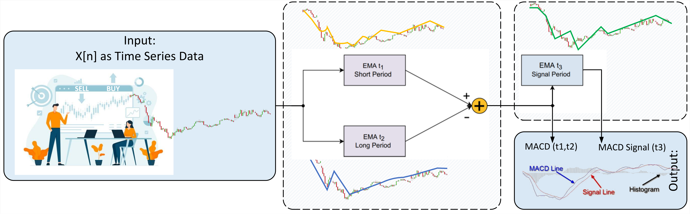
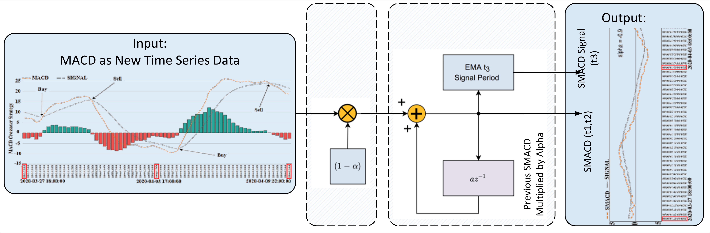
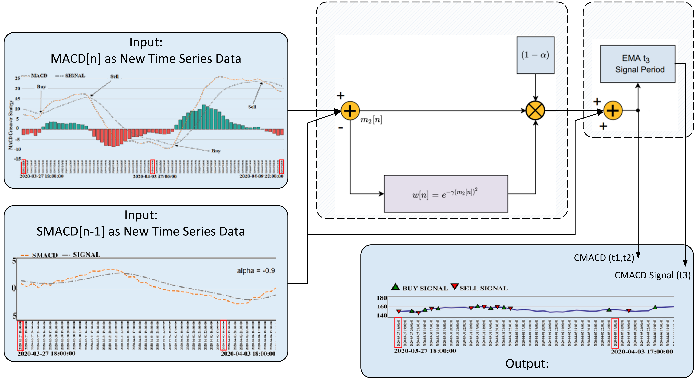

## Code for MACD Enhancement through Optimized Weighting and Stability Analysis

Table of contents
=================

<!--ts-->
  * [Background](#Background)
  * [Environment setup](#Environment-setup)
  * [Dataset](#Dataset)
  * [Run](#Run)
  * [Building the tables](#Building-the-tables)
  * [Repository layout](#Repository-layout)
  * [Citation and licence](#Citation-and-licence)

<!--te-->

Background
============
To make profits, capital market participants need to schedule correctly to exit and enter positions at perfect times, where finding the optimal time can be daunting. One of the technical indicators for different financial markets is moving average convergence divergence (MACD), which traders use to measure the performance and efficiency of the market and increase profit. In this paper, we introduce two new speeded and correntropy-based versions of MACD, which propose new mechanisms to boost the performance and stability of MACD and boost profit. Additionally, we proved the stability of the proposed methods for better performance evaluation. To avoid concerns over bias, we report the results over validation periods and deploy the systems on 1-day, 1-hour, and 5-minute time formats of financial securities. Our results show that using technical analysis strategies based on the original MACD indicator results in a low success rate of around 30% for individually tested stocks in the Dow group because of late and false signals associated with the indicator and in all benchmarks, the proposed methods perform better than MACD, and in some periods, the system outperforms the holding of the same stocks.

**SMACD** applies a shape parameter alpha to the histogram; **CMACD** adds a correntropy
gate gamma. Both are evaluated against standard MACD(12,26,9) across 32 US equities at
three timeframes under walk-forward validation, with three signal systems and two
crossover definitions. Three published studies are reproduced as case studies: Wiles &
Enke (2015) on soybean, Kang (2021) on the Nikkei 225, and Agudelo Aguirre et al. (2021)
on the NASDAQ Composite.

Environment setup
==================

    git clone https://github.com/alirezagmoghadam/macdpy.git
    cd macdpy
    conda env create -f environment.yml
    conda activate macdpy

Or with pip: `pip install -r requirements.txt`. Python 3.9+. The main dependencies are
pandas, numpy, `pygad` (the genetic-algorithm selection rule) and `arch` (Hansen's SPA
test and the bootstrap arms).

Dataset
-------------

**This repository ships no market data.** The dataset was acquired from
[Polygon.io](https://polygon.io/), whose licence does not permit redistribution. There
are two ways to get data, and they are not equivalent:

| | what you get | what it is good for |
|---|---|---|
| `make_synthetic_data.py` | random numbers | **checking the code runs.** Nothing else. |
| `download_polygon.py` | the real data, with your own API key | reproducing the paper |

### The synthetic data is not market data

`make_synthetic_data.py` generates prices from a geometric Brownian motion. They do not
correspond to any real security. **No number computed from synthetic data has any
economic meaning** - not a return, not a win ratio, not a p-value, not a confidence
interval. The script prints this warning when it runs and drops a
`SYNTHETIC_DATA_DO_NOT_CITE.txt` marker into every folder it writes, so that a results
tree built from it cannot later be mistaken for a real one.

It exists for one purpose: so that someone who has just cloned this repository can run
the pipeline end to end and see that it works, without a data subscription.

**Do not cite, publish, plot, or compare against anything derived from it.**

    python make_synthetic_data.py
    python experiment_main.py --timeframe 1_day --balance 20000 --sig 1 --ticker-index 1

Defaults are 4 tickers and 42 months, chosen because the daily branch uses a 12-month
selection window plus a 12-month validation window and then advances 3 months at a time,
so the window count is `1 + (months - 24) // 3`. 42 months gives 7 windows per config;
anything under 24 months completes having produced nothing, which looks like a bug and is
not one.

    python make_synthetic_data.py --tickers 8 --months 60   # more of both
    python make_synthetic_data.py --all-tickers             # all 32; large and slow

The generator **refuses to overwrite a data folder it did not create**, so it cannot
destroy real vendor data you have paid for. Pass `--force` to override.

### Reproducing the paper

You need a Polygon.io key with at least 5 years of intraday history. The free and Starter
tiers cap history at 2 years, which gives a shorter sample than the paper's and therefore
different walk-forward window counts - a subscription limit, not a bug. The download
script prints the span it actually received for every file, so any shortfall is visible
immediately rather than discovered later.

    pip install polygon-api-client     # only this script needs it
    export POLYGON_API_KEY=your_key_here
    python download_polygon.py --dry-run   # see the plan and the request count first
    python download_polygon.py --sleep 13  # respects the free tier's 5 calls/min

It skips files already on disk, so an interrupted run resumes. 32 tickers x 3 timeframes
= 96 paginated downloads.

`download_polygon.py` is a faithful port of `polygon_test.ipynb`, the notebook that
actually produced the data behind the published numbers. Its request parameters, column
layout and file naming are preserved deliberately, so a reader's download is comparable
with ours rather than merely similar. The notebook is kept here as provenance.

### The case-study data is not downloadable

The three case studies use a continuous soybean futures series, Nikkei 225 futures and
the NASDAQ Composite, none of which come from Polygon.
`build_soybean_continuous.py` builds the back-adjusted continuous series from
per-contract files, and `check_case_study_data.py` verifies that what you have reproduces
each paper's own anchor values. Sources are cited in the paper's data section.

Run
-----------------

    python experiment_main.py --timeframe {1_day,1_hour,5_minute} \
                              --balance {0,20000} \
                              --sig {1,2,3} \
                              [--ticker-index 1..32] \
                              [--session {full,regular}]

- `--balance 20000` is the compounding scenario; `0` is the fixed-size scenario.
- `--sig` selects the signal system: 1 plain crossover, 2 `signal_line_if`,
  3 `signal_line_if_target`.
- `--ticker-index` runs one ticker, for sharding across cores. Omit it to run all 32.
- `--session regular` keeps only 09:30-16:00 exchange local. The main runs keep extended
  hours by design; this is a robustness variant that writes to its own results folder.

**The daily run reads 5-minute bars, not daily bars.** The plain daily series decides and
fills on the same close, which is not tradeable. The daily series is therefore a
near-close build collapsed from intraday bars: the signal comes from the second-to-last
session bar and execution happens on the last, at the official close read from the daily
file. This is why both `data/stocks/5_minute/` and `data/stocks/1_day/` must be present
for a daily run, and why the synthetic generator pins its intraday path to the daily
close with a Brownian bridge rather than drawing the two independently.

The full sweep in the paper is roughly 1,565 CPU-hours. `run_sweep.py` shards it.

Building the tables
-----------------

    python preflight_results.py --root ./results   # gate: is the output usable?
    python make_tables_notebooks.py                # build the result tables

`preflight_results.py` decides whether a results tree is complete and self-consistent
before anything is built from it. Run it before trusting any table.
`show_tables.ipynb` loads and displays the tables once built.

The case-study and benchmark notebooks are `bh.ipynb` (buy-and-hold and equal-turnover
random benchmarks), `nasdaq.ipynb`, `nikkei.ipynb` and `soybean.ipynb`, with
`rules_table.ipynb` and `heatmap_plot.ipynb` for the selection-rule and parameter
figures.

Repository layout
-----------------

    experiment_main.py            the engine: indicators, strategies, walk-forward loop, CLI
    make_tables_notebooks.py      post-hoc tables, bootstrap CIs, regime splits, SPA
    preflight_results.py          completeness/consistency gate for a results tree
    run_sweep.py                  shards the full sweep across cores
    make_synthetic_data.py        synthetic data generator  (NOT market data)
    download_polygon.py           vendor download, your own API key
    build_soybean_continuous.py   back-adjusted continuous soybean series
    check_case_study_data.py      verifies case-study data against each paper's anchors
    run_case_study_spa.py         Hansen (2005) SPA for the case studies
    run_case_study_significance.py  bootstrap significance for the case studies
    run_case_study_sweep.py       sweeps the case-study parameter grids
    bh.ipynb                      buy-and-hold and equal-turnover random benchmarks
    nasdaq.ipynb                  case study: Agudelo Aguirre et al. (2021)
    nikkei.ipynb                  case study: Kang (2021)
    soybean.ipynb                 case study: Wiles & Enke (2015)
    rules_table.ipynb             selection-rule summary table
    heatmap_plot.ipynb            parameter heatmaps
    correlation.ipynb             cross-ticker correlation figures
    get_return_log_plot.ipynb     cumulative log-return figures
    plot_positions.ipynb          position/trade diagnostic plots
    show_tables.ipynb             loads and displays the built tables
    polygon_test.ipynb            the original download notebook, kept as provenance

Citation and licence
-----------------

Under review at JEFAS (Emerald). Manuscript available on request.

The code in this repository is released under the MIT Licence; see `LICENSE`. The licence
covers the code only.

The vendor data is not redistributed here, and the published figures reproduced in the
comparison tables belong to their respective authors and are quoted for comparison under
normal academic practice.
